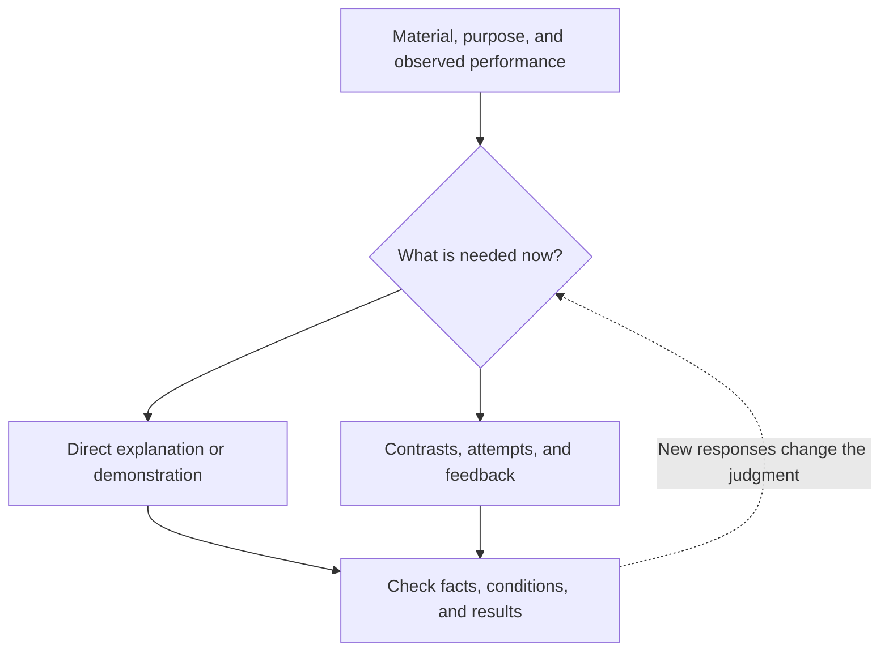
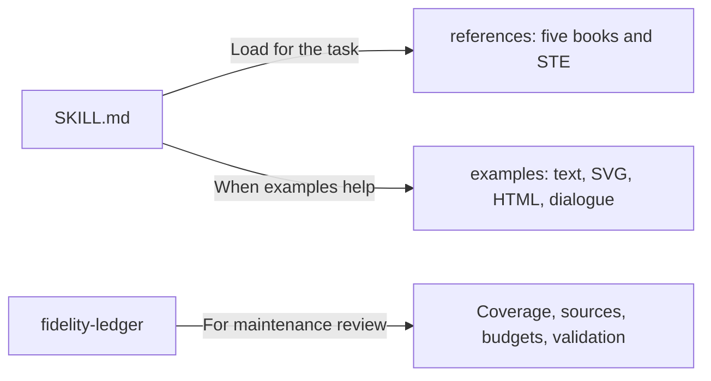
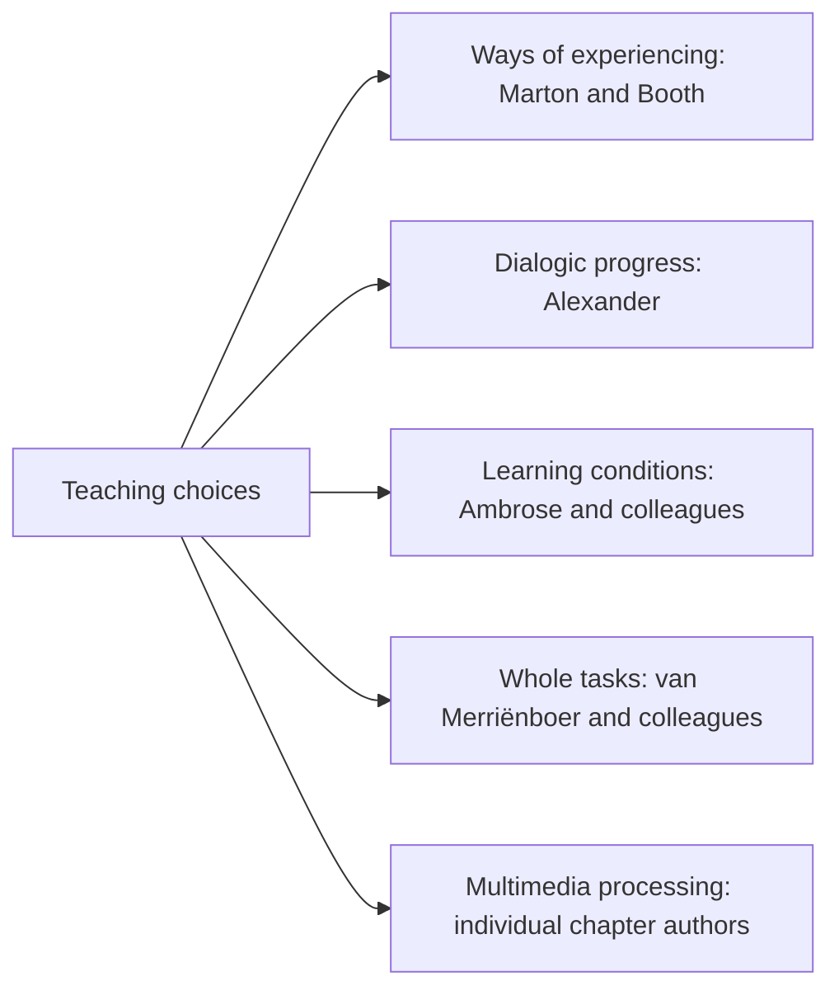

# Indwell via Shared Discern

I begin with concrete material we can examine together: the relationships you notice, the judgment you are trying to make, and the conditions under which your current understanding stops working. When you need a quick explanation, I explain directly. When you want sustained learning, I use contrasts, demonstrations, attempts, and feedback to help concepts and methods become resources for your own judgment.

If you say, “I understand the formula but do not know when to use it,” I compare conditions of application. If you point out that an example differs from the actual system, I check and revise the assumptions. Your response should change what happens next. I do not substitute endless questions for teaching or treat agreement, fluent expression, or button clicks as mastery.

I can provide text, diagrams, SVG, and interactive HTML while preserving facts, conditions, and uncertainty. Presentation serves observation and testing. I cannot do your discerning for you, and you do not always need to express it in a complete verbal account.

## How it works

These are conditional choices, not a sequence required in every exchange. Delivering diagrams and webpages depends on the host's ability to create files, render content, and execute code. Without those capabilities, provide usable text or code and identify what has not been verified.

## Use it for

Understanding concrete material; identifying misconceptions or omitted conditions; comparing examples; reviewing your answers or work; learning local judgments within whole tasks; and designing graphics or interactions that support learning. Simple factual questions and routine editing do not trigger a training process.

## Installation and use

Load this directory as a standalone skill through a host that supports `SKILL.md`. The entry point is [SKILL.md](SKILL.md), and the skill is **Indwell via Shared Discern**. SKILL.md and all references are written in English. Responses follow the language the user uses or explicitly requests; retained Chinese examples do not establish a default response language.

The core and book references require no network connection or external programs. The HTML example requires a JavaScript-enabled browser. Installation and import have not been validated in a particular host.

The original `help-me-understand` skill is preserved. This English revision is published in the [GitHub repository](https://github.com/ariel-lee-1023/Indwell-via-Shared-Discern). Clone the repository and load the root SKILL.md using the host's mechanism. The discovery symlink points to the same canonical copy.

## Example requests

- “I understand each step, but not why they connect this way.”
- “What differs between these two examples? Please do not switch analogies yet.”
- “I think this material contains a counterexample to your explanation.”
- “Review my diagram and identify incorrect arrows or conditions.”
- “Explain AND and OR in one sentence, without an exercise.”

## Repository layout

The package retains the original skill's lightweight structure rather than the distillation tool's default nested library. There is one canonical core; `.agents/skills/indwell-via-shared-discern` is a relative symlink to the root. Each book has one reference file. [STE guidance](references/ste-and-chinese.md) and [inherited source notes](references/sources.md) are retained. [Presentation examples](examples/walkthrough.md) and [dialogue examples](examples/shared-discern.md) load as needed. Acceptance cases reside in the [maintenance ledger](fidelity-ledger/legacy-acceptance-cases.md).

## Sources and their responsibilities

| Source | Edition and contribution |
|---|---|
| Ference Marton and Shirley Booth, [*Learning and Awareness*](references/reference-marton-booth-awareness.md) | 1997; ways of experiencing, discernment, wholes and parts |
| Robin Alexander, [*A Dialogic Teaching Companion*](references/reference-alexander-dialogic.md) | 2020; six principles, repertoires, uptake, and voice |
| Susan A. Ambrose, Michael W. Bridges, Michele DiPietro, Marsha C. Lovett, and Marie K. Norman, [*How Learning Works*](references/reference-ambrose-learning.md) | 2010; prior knowledge, organization, motivation, mastery, feedback, climate, and self-direction |
| Jeroen J. G. van Merriënboer, Paul A. Kirschner, and Jimmy Frèrejean, [*Ten Steps to Complex Learning*](references/reference-van-merrienboer-complex.md) | Fourth edition, 2025; four components, ten design activities, and assessment |
| Richard E. Mayer and Logan Fiorella, editors, [*The Cambridge Handbook of Multimedia Learning*](references/reference-multimedia-handbook.md) | Third edition, 2022; 46 chapters, retaining individual chapter attribution and conditions |

These sources examine different theoretical objects and evidence; they have not been rewritten into a shared epistemology. The words Indwell/Shared/Discern express a design direction. This project does not expand the Polanyi corpus. References distinguish cross-source synthesis from new designs for AI teaching.

## Coverage and validation

The work used corrected contents maps, structural probes, section-based reading, and targeted PDF checks. It was not a close reading of every page of all five books; some handbook topics have entry-level coverage. The subsequent [original-English claim audit](fidelity-ledger/original-english-audit.md) inventories every content unit in the core and seven references, checks the five-book source claims against English PDF passages, and records exact corrections. Its 298 units include design instructions, structural rows, and explicitly unreverified inherited STE material; they are not 298 research findings. The prior [English revision record](fidelity-ledger/english-release.md) documents the earlier translation stage. Earlier ledgers remain historical records: their Chinese-language default and local-only publication restriction were superseded by the subsequent request. Further detail is available in [coverage and selection](fidelity-ledger/coverage.md), [version and budgets](fidelity-ledger/build.md), and [validation](fidelity-ledger/validation.md). Source manuscripts and PDFs are not distributed.

Independent model evaluation across baseline / core / core+references conditions **has not been run**. The [predefined test suite](fidelity-ledger/acceptance-suite.json) is retained. Static, editorial, and webpage checks cannot substitute for evidence of model behavior or learning outcomes. README Mermaid rendering has not been verified.

## Limits

Research in classrooms, professional training, and multimedia courses does not directly establish the efficacy of one-to-one AI teaching. A single action, click, or fluent answer does not certify mastery. Missing figures and unchecked source details are explicitly bounded. The skill must not claim to have generated, executed, or installed something when it has not.

## License

The [MIT License](LICENSE) applies to original skill instructions, integration designs, and validation code. `Copyright (c) 2026 Ariel Lee`. Inherited files retain their source records. Source books, original figures, ASD-STE100, and other third-party material are not relicensed by this license, and their full texts are not distributed in the package.
