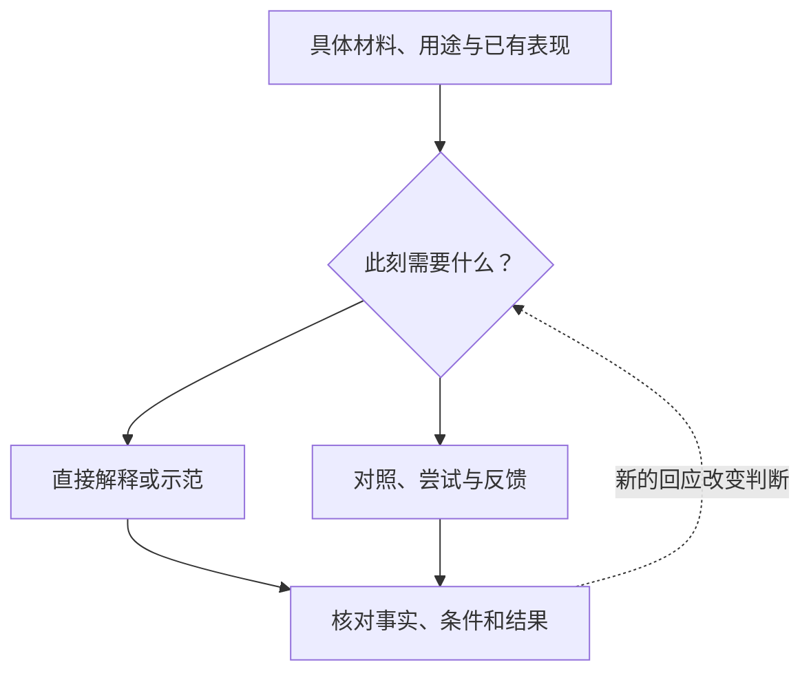
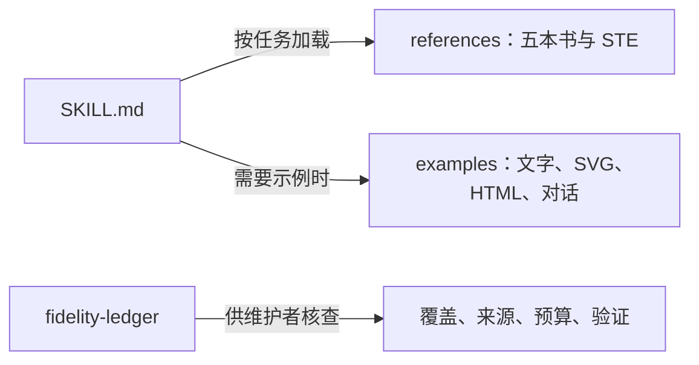
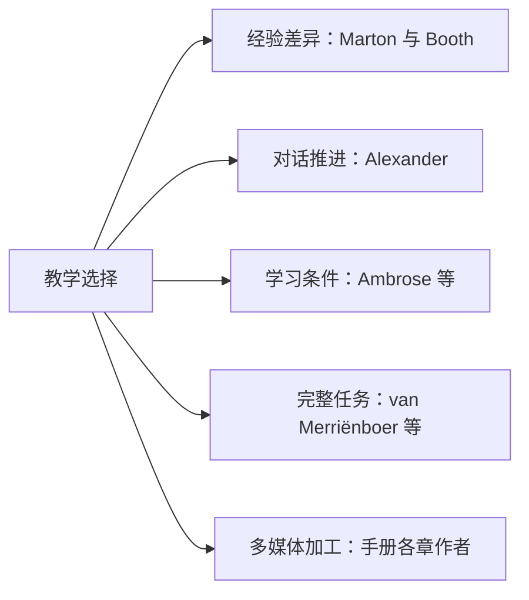

# indwell-via-shared-discern

我会先和你面对一份具体材料：你在其中看到了什么关系，正在判断什么，又是哪处条件让原来的理解行不通。你只需快速解释时，我就直接讲清楚；你想持续学习时，我会用对照、示范、尝试和反馈，帮助概念与方法逐渐成为你自己的判断依据。

如果你说“我懂公式，却不知道什么时候用”，我会比较适用条件；如果你指出例子与实际系统不同，我会检查并修正假设。你的回应应改变下一步。我不会用连续提问代替教学，也不会把赞同、流畅表达或点过按钮当作掌握。

我可以提供文字、图示、SVG 和交互 HTML，同时保住事实、条件和不确定性。形式服务于观察与检验；你自己的辨别不能由我代做，也不必总用完整语言表达。

## 怎样工作

这是一组选择关系，不是每次必须执行的流程。图示与网页交付取决于宿主是否能写文件、渲染和运行；没有这些能力时提供可实际交付的文字或代码，并说明未验证部分。

## 适用任务

看懂具体材料；发现误解或遗漏的条件；比较例子；检查自己的回答或作品；学习完整任务中的局部判断；设计有学习用途的图文或交互。简单事实问答、普通润色不展开训练。

## 本地使用

将本目录作为独立技能包，交由支持 `SKILL.md` 的宿主按其机制加载；入口为 [SKILL.md](SKILL.md)，名称为 `indwell-via-shared-discern`。SKILL.md 与全部 references 使用英文；回复跟随用户所用语言或其明确指定的语言。保留的中文示例不设定默认语言。核心和书目参考不依赖联网或外部程序；HTML 示例需要支持 JavaScript 的浏览器。没有在特定宿主完成安装/导入验证。

原 `help-me-understand` 保留。本次英文修订按用户后续授权发布至 [GitHub 仓库](https://github.com/ariel-lee-1023/indwell-via-shared-discern)。可克隆仓库后按宿主机制加载根目录 SKILL.md；仓库发现链接指向同一规范副本。

## 请求示例

- “我懂每一步，但不知道它们为什么要这样连起来。”
- “这两个例子哪里不同？先别换类比。”
- “我觉得你的解释有反例，看看这份材料。”
- “检查我的图，指出箭头或条件哪里错了。”
- “只用一句话说明 AND 和 OR，不用练习。”

## 目录与加载

沿用原技能的轻量结构，未套用蒸馏工具默认的嵌套库。一个规范主体；`.agents/skills/indwell-via-shared-discern` 以相对链接指向根目录；五书各一份参考；[STE](references/ste-and-chinese.md) 与[旧来源记录](references/sources.md)保留。[交付示例](examples/walkthrough.md)和[对话示例](examples/shared-discern.md)按需加载。验收案例迁入[维护账本](fidelity-ledger/legacy-acceptance-cases.md)。

## 来源与分工

| 来源 | 版本与贡献 |
|---|---|
| Ference Marton、Shirley Booth，[*Learning and Awareness*](references/reference-marton-booth-awareness.md) | 1997；经验方式、辨识、整体与部分 |
| Robin Alexander，[*A Dialogic Teaching Companion*](references/reference-alexander-dialogic.md) | 2020；六原则、手段库、回应与声音 |
| Susan A. Ambrose、Michael W. Bridges、Michele DiPietro、Marsha C. Lovett、Marie K. Norman，[*How Learning Works*](references/reference-ambrose-learning.md) | 2010；先前知识、组织、动机、熟练、反馈、气氛与自主学习 |
| Jeroen J. G. van Merriënboer、Paul A. Kirschner、Jimmy Frèrejean，[*Ten Steps to Complex Learning*](references/reference-van-merrienboer-complex.md) | 第四版，2025；四组件、十项设计活动与评价 |
| Richard E. Mayer、Logan Fiorella 编，[*The Cambridge Handbook of Multimedia Learning*](references/reference-multimedia-handbook.md) | 第三版，2022；46章，按章作者保留归属与条件 |

这些来源有不同理论对象与证据，未被改写为共同认识论。indwell/shared/discern 是设计方向；本次没有扩充波兰尼语料。跨书综合与面向 AI 的新设计在参考中另行标明。

## 覆盖与验证

采用目录校正、结构探测、正文分段阅读及 PDF 定向核验。不是五书逐页精读；手册专题存在入口级覆盖。英文修订核验见[本次发布记录](fidelity-ledger/english-release.md)。早期账本保留为历史记录，其中文语言约定和不发布限制已被本次请求覆盖。详见[覆盖与取舍](fidelity-ledger/coverage.md)、[版本与预算](fidelity-ledger/build.md)、[验证记录](fidelity-ledger/validation.md)。书稿和 PDF 不随包分发。

独立模型的 baseline / core / core+references 三条件行为验收**尚未运行**；保留[预先定义的测试集](fidelity-ledger/acceptance-suite.json)。静态、语义和网页检查不能代替模型行为或学习效果证据。

## 限制

课堂、专业训练、多媒体课程的研究不能直接证明一对一 AI 教学有效。一次操作、点击或流畅回答不构成掌握认证。来源缺图或未核验部分明确限定；不虚称已生成、运行或安装。

## License

[MIT License](LICENSE)适用于本次原创技能说明、整合设计及验证代码。`Copyright (c) 2026 Ariel Lee`。原有文件保留其来源记录；书稿、原图、ASD-STE100 标准与其他第三方内容不由本许可重新授权，也不随包提供其全文。
